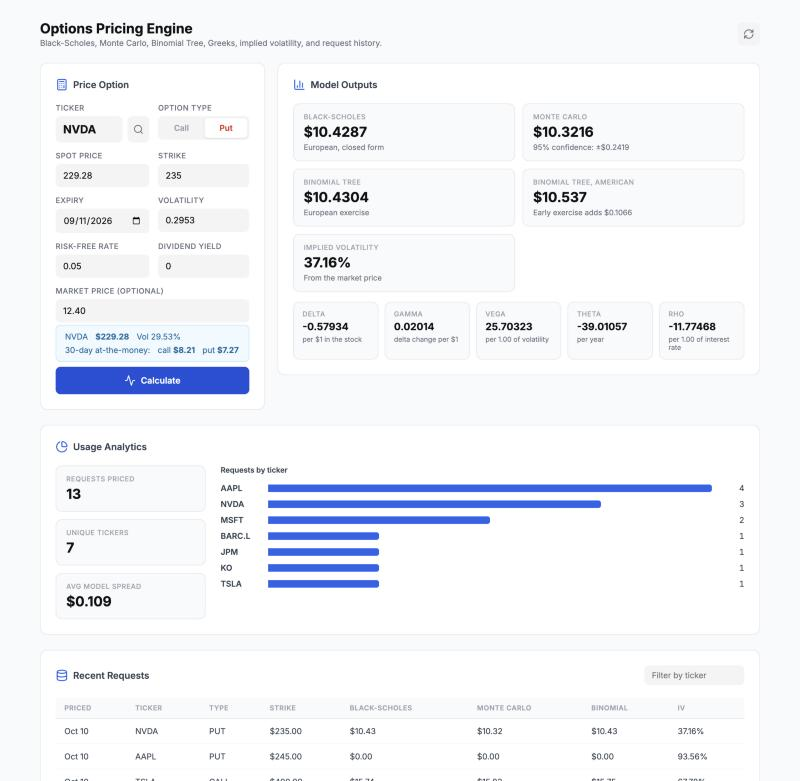
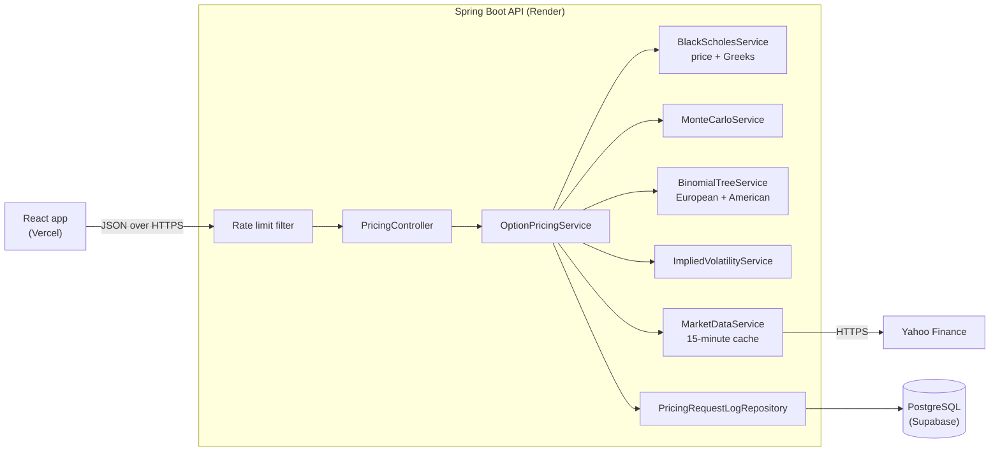

# Options Pricing Engine

[](https://github.com/Vish2501/option-pricing-engine/actions/workflows/ci.yml)

Prices equity options with three models side by side, backs out implied volatility, and
keeps a queryable log of every request. Java and Spring Boot API, PostgreSQL, React front end.

**Live demo:** https://option-pricing-engine-delta.vercel.app
(API docs: https://option-pricing-api.onrender.com/swagger-ui.html)

> The demo runs on free hosting that sleeps when idle. Outside UK working hours the first
> request can take up to three minutes while the server wakes; the page says so while it waits.



## What it does

- **Three pricing models, compared.** Black-Scholes-Merton (closed form), Monte Carlo
  (10,000 simulated paths) and a Cox-Ross-Rubinstein binomial tree (500 steps), all with a
  continuous dividend yield.
- **American exercise.** The tree is also run allowing early exercise, and the response
  reports the early-exercise premium over the European price.
- **Honest Monte Carlo.** The estimate comes with its standard error, shown as a 95%
  confidence interval.
- **Greeks.** Delta, gamma, vega, theta and rho, with their units stated.
- **Implied volatility.** Newton-Raphson with a bisection fallback. A market price that no
  volatility could produce (outside no-arbitrage bounds) returns no answer instead of a
  meaningless one.
- **Market data.** Search by company name or symbol, then pull the latest price and a
  30-day historical volatility from Yahoo Finance.
- **Request log and analytics.** Every pricing is saved to PostgreSQL. History can be
  filtered by ticker and paged; usage analytics are aggregated in SQL.

## How it relates to the project it started from

This began as a Java port of the Python/Streamlit project
[saeedbidi/option_pricing](https://github.com/saeedbidi/option_pricing). The choice of models
and the market-data approach come from there, and one test checks the Black-Scholes price,
Greeks and implied volatility against that project's sample report.

What this version adds:

- A REST API and a separate React front end in place of a single Streamlit script.
- PostgreSQL persistence with Flyway migrations, request history and SQL analytics.
- American exercise, a Monte Carlo standard error, and the no-arbitrage check on implied volatility.
- Ticker search, market-data caching, input validation and consistent JSON errors.
- Per-IP rate limiting, since the API is public.
- Automated tests (including a run against real PostgreSQL), CI, Docker and a live deployment.

## Architecture



`OptionPricingService` orchestrates one request: resolve inputs (from the request or from
market data), run each model, solve implied volatility if a market price was given, and save
the result. Each model lives in its own service with no dependency on the web or database
layers, so the maths can be unit-tested directly.

## Tech stack

| Layer | Technology |
|---|---|
| API | Java 17, Spring Boot 3.2 (Web, Data JPA, Security, Validation, Actuator), springdoc OpenAPI |
| Database | PostgreSQL, Flyway migrations |
| Front end | React 18, TypeScript, Vite |
| Tests | JUnit 5, MockMvc, Vitest, Testing Library |
| Delivery | GitHub Actions, Docker, Render (API), Vercel (front end), Supabase (database) |

## Run it locally

You need Java 17 or 21, Maven, Node 20+ and PostgreSQL (or Docker). Spring Boot 3.2 does not
support newer Java versions; if your default is newer, point `JAVA_HOME` at 17 or 21 first.

```bash
# 1. Database
cd backend
docker compose up postgres -d

# 2. API on http://localhost:8080
export SPRING_DATASOURCE_PASSWORD=postgres
mvn spring-boot:run

# 3. Front end on http://localhost:5173 (proxies /api to the API)
cd ../frontend
npm install
npm run dev
```

Without Docker, create a database called `option_pricing` and point the API at it with
`SPRING_DATASOURCE_URL`, `SPRING_DATASOURCE_USERNAME` and `SPRING_DATASOURCE_PASSWORD`.
See [backend/README.md](backend/README.md) for every setting.

## API

All routes are under `/api/v1`. Interactive docs are at `/swagger-ui.html`.

| Method and path | Purpose |
|---|---|
| `POST /price` | Price an option with all models; saves the request |
| `GET /stock/{ticker}` | Latest price and 30-day historical volatility |
| `GET /tickers/search?q=` | Find stocks and ETFs by name or symbol |
| `GET /price/compare/{ticker}` | 30-day at-the-money call and put for a ticker |
| `GET /history?ticker=&page=&size=` | Saved requests, newest first; total in `X-Total-Count` |
| `GET /history/analytics` | Request counts by ticker, average prices, average model spread |

Example request:

```json
{
  "ticker": "AAPL",
  "spotPrice": 226.5,
  "strike": 207.5,
  "expiry": "2027-06-18",
  "optionType": "CALL",
  "volatility": 0.2191,
  "riskFreeRate": 0.05,
  "dividendYield": 0.005,
  "marketPrice": 32.5
}
```

Only `ticker`, `strike`, `expiry` and `optionType` are required. A missing spot price or
volatility is fetched from market data; a missing rate or dividend yield uses the default.
Errors always come back as `{"message": "...", "timestamp": "..."}`.

## Tests

```bash
cd backend && mvn test            # 67 tests
cd frontend && npm test           # 17 tests
cd frontend && npm run lint
```

- **Pricing maths:** known values, put-call parity, tree convergence to Black-Scholes,
  Greeks checked against finite differences, implied-volatility round trips, American
  exercise properties, and the Monte Carlo error shrinking with more paths.
- **API:** validation, error format, history filtering and paging, analytics, rate limiting.
- **Market data:** Yahoo responses are stubbed, so tests never call the real service.
- **PostgreSQL:** one test runs the Flyway migrations and the aggregate queries against a
  real PostgreSQL database. It runs in CI, and locally when `POSTGRES_TEST_URL` is set; the
  rest use in-memory H2 for speed.

## Design decisions and known limitations

- **Market data is unofficial.** Yahoo Finance's chart endpoint has no API contract and can
  change or rate-limit without notice. Results are cached for 15 minutes to stay well within
  its limits, so the "live" price can be that old. A paid provider behind the same service
  would be the fix.
- **No logins.** The API is public by design. It is protected by rate limiting only, the
  client is identified by a header that can be forged, and the counters live in memory, so
  they reset on restart and would not be shared across several instances.
- **Monte Carlo uses a fixed seed.** The same inputs always give the same price, which keeps
  results reproducible. The standard error says how far that one draw could be off.
- **Monte Carlo and Black-Scholes are European only.** American exercise is priced by the
  tree alone.
- **Prices are `double`, not `BigDecimal`.** These are model outputs, not ledger amounts,
  and the numerical error of the models is far larger than floating-point error.
- **Constant volatility and rates.** No volatility smile, term structure or discrete dividends.
- **Day count is calendar days over 365.**
- **Free hosting.** A scheduled GitHub Actions job pings the API during UK working hours to
  keep it awake; outside those hours the first request is slow.

## Deployment

The API deploys to Render from `backend/Dockerfile` and the front end to Vercel from
`frontend/`; both redeploy on every push to `main`. Settings are in
[backend/README.md](backend/README.md) and [frontend/README.md](frontend/README.md).

## Licence

[MIT](LICENSE)
