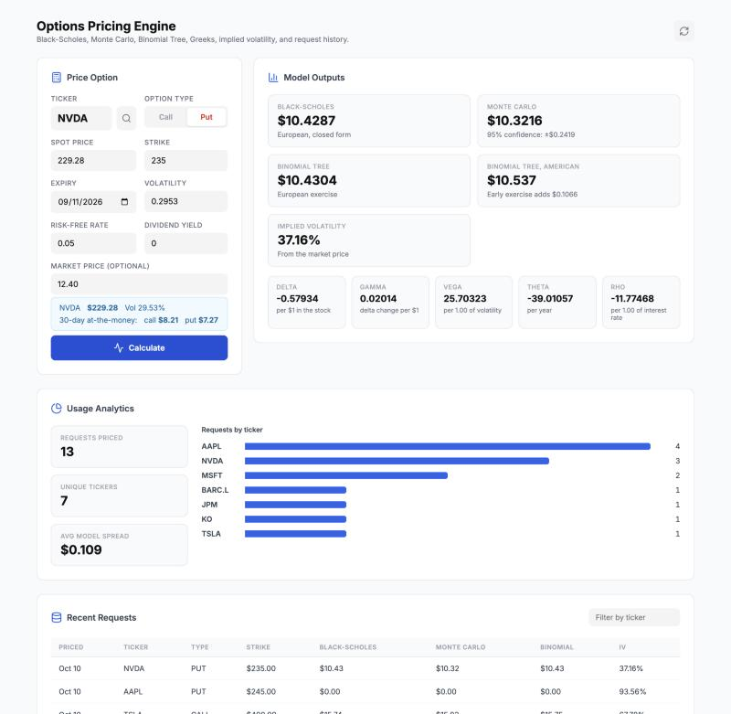
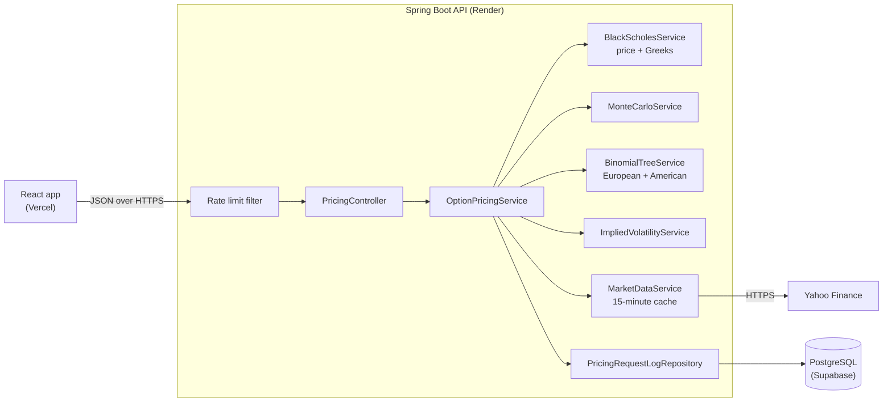

# Options Pricing Engine

[](https://github.com/Vish2501/option-pricing-engine/actions/workflows/ci.yml)

Prices equity options with three models side by side, backs out implied volatility, and
keeps a queryable log of every request. Java and Spring Boot API, PostgreSQL, React front end.

**Live demo:** https://option-pricing-engine-delta.vercel.app
(API docs: https://option-pricing-api.onrender.com/swagger-ui.html)

> The demo runs on free hosting that sleeps when idle. Outside UK working hours the first
> request can take up to three minutes while the server wakes; the page says so while it waits.



## What it does

- **Three pricing models, compared.** Black-Scholes-Merton (closed form), Monte Carlo
  (10,000 simulated paths) and a Cox-Ross-Rubinstein binomial tree (500 steps), all with a
  continuous dividend yield.
- **American exercise.** The tree is also run allowing early exercise, and the response
  reports the early-exercise premium over the European price.
- **Honest Monte Carlo.** The estimate comes with its standard error, shown as a 95%
  confidence interval.
- **Greeks.** Delta, gamma, vega, theta and rho, with their units stated.
- **Implied volatility.** Newton-Raphson with a bisection fallback. A market price that no
  volatility could produce (outside no-arbitrage bounds) returns no answer instead of a
  meaningless one.
- **Market data.** Search by company name or symbol, then pull the latest price and a
  30-day historical volatility from Yahoo Finance.
- **Request log and analytics.** Every pricing is saved to PostgreSQL. History can be
  filtered by ticker and paged; usage analytics are aggregated in SQL.

## How it relates to the project it started from

This began as a Java port of the Python/Streamlit project
[saeedbidi/option_pricing](https://github.com/saeedbidi/option_pricing). The choice of models
and the market-data approach come from there, and one test checks the Black-Scholes price,
Greeks and implied volatility against that project's sample report.

What this version adds:

- A REST API and a separate React front end in place of a single Streamlit script.
- PostgreSQL persistence with Flyway migrations, request history and SQL analytics.
- American exercise, a Monte Carlo standard error, and the no-arbitrage check on implied volatility.
- Ticker search, market-data caching, input validation and consistent JSON errors.
- Per-IP rate limiting, since the API is public.
- Automated tests (including a run against real PostgreSQL), CI, Docker and a live deployment.

## Architecture



`OptionPricingService` orchestrates one request: resolve inputs (from the request or from
market data), run each model, solve implied volatility if a market price was given, and save
the result. Each model lives in its own service with no dependency on the web or database
layers, so the maths can be unit-tested directly.

## Tech stack

| Layer | Technology |
|---|---|
| API | Java 17, Spring Boot 3.2 (Web, Data JPA, Security, Validation, Actuator), springdoc OpenAPI |
| Database | PostgreSQL, Flyway migrations |
| Front end | React 18, TypeScript, Vite |
| Tests | JUnit 5, MockMvc, Vitest, Testing Library |
| Delivery | GitHub Actions, Docker, Render (API), Vercel (front end), Supabase (database) |

## Run it locally

You need Java 17 or 21, Maven, Node 20+ and PostgreSQL (or Docker). Spring Boot 3.2 does not
support newer Java versions; if your default is newer, point `JAVA_HOME` at 17 or 21 first.

```bash
# 1. Database
cd backend
docker compose up postgres -d

# 2. API on http://localhost:8080
export SPRING_DATASOURCE_PASSWORD=postgres
mvn spring-boot:run

# 3. Front end on http://localhost:5173 (proxies /api to the API)
cd ../frontend
npm install
npm run dev
```

Without Docker, create a database called `option_pricing` and point the API at it with
`SPRING_DATASOURCE_URL`, `SPRING_DATASOURCE_USERNAME` and `SPRING_DATASOURCE_PASSWORD`.
See [backend/README.md](backend/README.md) for every setting.

## API

All routes are under `/api/v1`. Interactive docs are at `/swagger-ui.html`.

| Method and path | Purpose |
|---|---|
| `POST /price` | Price an option with all models; saves the request |
| `GET /stock/{ticker}` | Latest price and 30-day historical volatility |
| `GET /tickers/search?q=` | Find stocks and ETFs by name or symbol |
| `GET /price/compare/{ticker}` | 30-day at-the-money call and put for a ticker |
| `GET /history?ticker=&page=&size=` | Saved requests, newest first; total in `X-Total-Count` |
| `GET /history/analytics` | Request counts by ticker, average prices, average model spread |

Example request:

```json
{
  "ticker": "AAPL",
  "spotPrice": 226.5,
  "strike": 207.5,
  "expiry": "2027-06-18",
  "optionType": "CALL",
  "volatility": 0.2191,
  "riskFreeRate": 0.05,
  "dividendYield": 0.005,
  "marketPrice": 32.5
}
```

Only `ticker`, `strike`, `expiry` and `optionType` are required. A missing spot price or
volatility is fetched from market data; a missing rate or dividend yield uses the default.
Errors always come back as `{"message": "...", "timestamp": "..."}`.

## FIX interface

Alongside REST, the engine can answer quote requests over FIX 4.4, the messaging protocol
trading systems use to talk to each other. It runs inside the same Spring Boot app as an
acceptor (server) built on [QuickFIX/J](https://www.quickfixj.org/), and is **off by
default**; the deployed demo is REST only.

A FIX request goes through the same `OptionPricingService.price` call as `POST /price`, so
it is validated by the same rules, priced by the same models and saved to the same
`pricing_requests` table.

| Message | Direction | Meaning |
|---|---|---|
| QuoteRequest (`35=R`) | client to engine | Ask for a price on one option |
| Quote (`35=S`) | engine to client | Bid, offer and mid for that option |
| QuoteRequestReject (`35=AG`) | engine to client | The request could not be priced; `Text` (58) says why |
| BusinessMessageReject (`35=j`) | engine to client | Any other message type, or an unexpected failure |

Fields read from a QuoteRequest:

| Tag | Field | Maps to | Notes |
|---|---|---|---|
| 131 | QuoteReqID | echoed on the reply | Required |
| 146 | NoRelatedSym | | Must be 1: one option per request |
| 55 | Symbol | `ticker` | Required |
| 167 | SecurityType | | Required, must be `OPT` |
| 201 | PutOrCall | `optionType` | Required; `0` = put, `1` = call |
| 202 | StrikePrice | `strike` | Required |
| 541 | MaturityDate | `expiry` | Required; `YYYYMMDD` |
| 5001 | Pricing model (custom) | which model's price is quoted | Optional; `BS` (default), `MC` or `BT` |

Spot price and volatility are not sent; they come from market data, as they do for a REST
request that leaves them out. The Quote returns the chosen model's price as `MidPx` (631),
with `BidPx` (132) and `OfferPx` (133) placed symmetrically around it. The width is
`fix.spread-bps` in basis points of the price: the default of 100 puts each side 0.5% away.

Run it:

```bash
cd backend && FIX_ENABLED=true mvn spring-boot:run     # FIX on port 9876, REST still on 8080
```

Connect any FIX 4.4 client as `SenderCompID=CLIENT`, `TargetCompID=PRICER`. The session
settings are in [acceptor.cfg](backend/src/main/resources/fix/acceptor.cfg); the port
(`FIX_PORT`) and spread are in [application.yml](backend/src/main/resources/application.yml).

A request for a Black-Scholes quote on an AAPL 207.5 call, and the reply (`|` stands for the
SOH delimiter, byte `0x01`):

```text
8=FIX.4.4|9=116|35=R|34=2|49=CLIENT|52=20261116-18:39:14.483|56=PRICER|131=REQ-1|146=1|55=AAPL|167=OPT|541=20261216|201=1|202=207.5|10=171|

8=FIX.4.4|9=220|35=S|34=2|49=PRICER|52=20261116-18:39:14.501|56=CLIENT|55=AAPL|60=20261116-18:39:14.501|117=dc2059c8-b793-4b08-a914-0e1290cbacb5|131=REQ-1|132=20.1852|133=20.3881|167=OPT|201=1|202=207.5|541=20261216|631=20.2866|5001=BS|10=239|
```

Limits: the FIX port has no API key or rate limiting, only the CompID check, so it is meant
for local use. Sequence numbers are held in memory and reset at each logon, so there is no
message recovery after a restart. Saved rows do not record that they came from FIX or which
model was quoted.

## Tests

```bash
cd backend && mvn test            # 84 tests
cd frontend && npm test           # 17 tests
cd frontend && npm run lint
```

- **Pricing maths:** known values, put-call parity, tree convergence to Black-Scholes,
  Greeks checked against finite differences, implied-volatility round trips, American
  exercise properties, and the Monte Carlo error shrinking with more paths.
- **API:** validation, error format, history filtering and paging, analytics, rate limiting.
- **FIX:** a QuickFIX/J client connects to the running acceptor over a local socket and
  checks the Quote and both kinds of rejection; the field mapping has its own unit tests.
- **Market data:** Yahoo responses are stubbed, so tests never call the real service.
- **PostgreSQL:** one test runs the Flyway migrations and the aggregate queries against a
  real PostgreSQL database. It runs in CI, and locally when `POSTGRES_TEST_URL` is set; the
  rest use in-memory H2 for speed.

## Design decisions and known limitations

- **Market data is unofficial.** Yahoo Finance's chart endpoint has no API contract and can
  change or rate-limit without notice. Results are cached for 15 minutes to stay well within
  its limits, so the "live" price can be that old. A paid provider behind the same service
  would be the fix.
- **No logins.** The API is public by design. It is protected by rate limiting only, the
  client is identified by a header that can be forged, and the counters live in memory, so
  they reset on restart and would not be shared across several instances.
- **Monte Carlo uses a fixed seed.** The same inputs always give the same price, which keeps
  results reproducible. The standard error says how far that one draw could be off.
- **Monte Carlo and Black-Scholes are European only.** American exercise is priced by the
  tree alone.
- **Prices are `double`, not `BigDecimal`.** These are model outputs, not ledger amounts,
  and the numerical error of the models is far larger than floating-point error.
- **Constant volatility and rates.** No volatility smile, term structure or discrete dividends.
- **Day count is calendar days over 365.**
- **Free hosting.** A scheduled GitHub Actions job pings the API during UK working hours to
  keep it awake; outside those hours the first request is slow.

## Deployment

Every pull request, and every push to `main`, runs three CI jobs: the backend tests
(including the PostgreSQL one), the front-end lint, tests and build, and a build of the
backend Docker image.

- **`main` is protected.** Changes arrive by pull request and can only merge once all three
  jobs pass.
- **The API** deploys to Render from `backend/Dockerfile`. Render waits for the CI checks on
  a commit to pass before deploying it, and only switches traffic once `/health` responds.
- **The front end** deploys to Vercel from `frontend/` on every push to `main`. Vercel does
  not wait for CI itself; branch protection is what stops a failing commit reaching it.

Settings are in [backend/README.md](backend/README.md) and
[frontend/README.md](frontend/README.md).

## Licence

[MIT](LICENSE)
